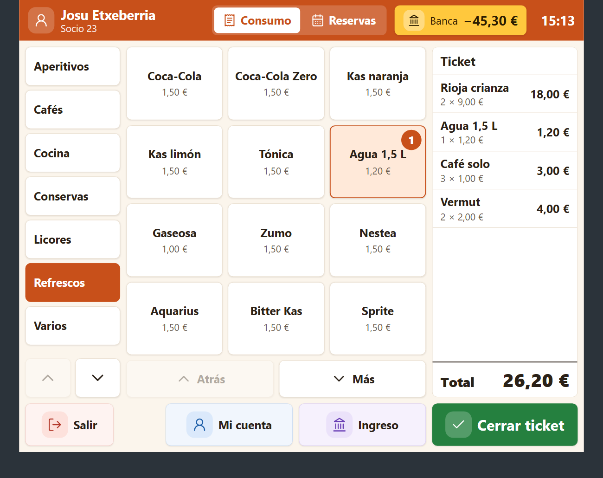
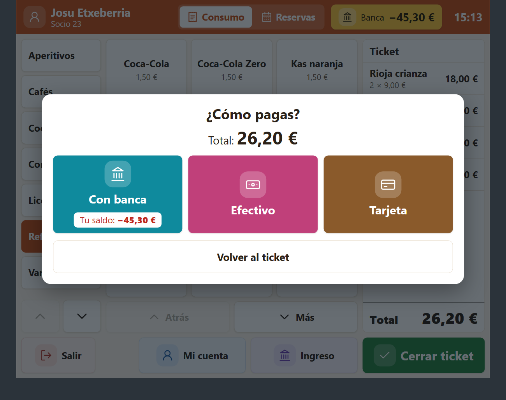
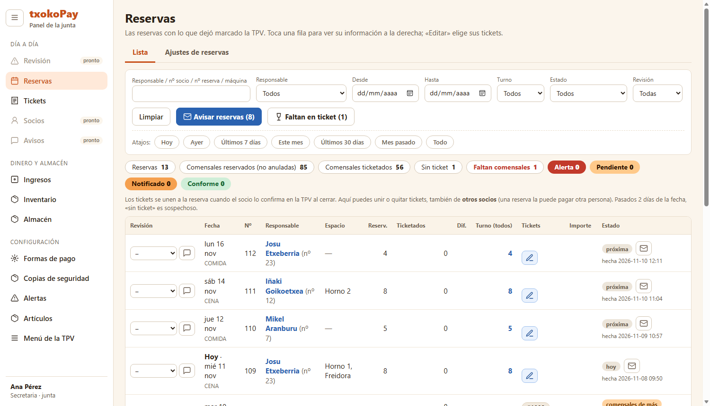
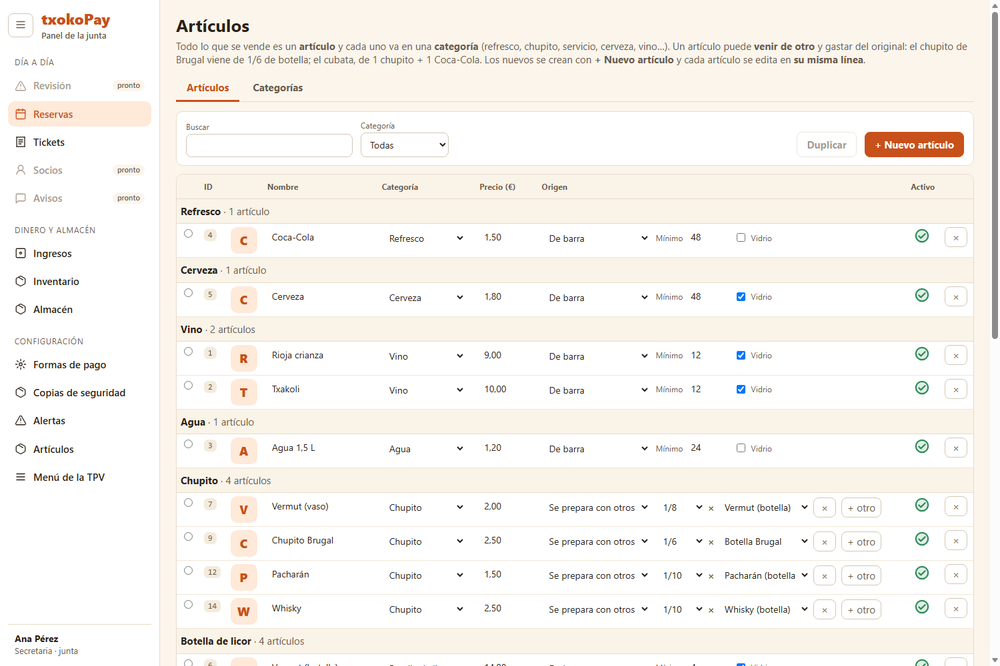

# txokoPay

Una aplicación para sociedades gastronómicas: lleva el día a día del local, desde el mostrador hasta la junta.

> **Estado:** en diseño. Se están definiendo las necesidades y probando prototipos; todavía no hay nada que instalar.

## Qué quiere ser

- **TPV táctil** para el mostrador: botones grandes y pantallas sencillas, pensadas para que cualquier socio la use sin dudar, sea cual sea su edad.
- **Reservas** integradas en la propia TPV: almuerzos, comidas, meriendas y cenas, con calendario por semanas, máquinas (horno, freidora) por turno y días cerrados por eventos.
- **Banca del socio**: un saldo propio en la sociedad (no es un banco real), con ingresos y formas de pago que la junta activa o desactiva: banca, efectivo y datáfono.
- **Panel de la junta**: revisión de reservas y tickets con estados y colores, ingresos y caja, alertas configurables y avisos a los socios.
- **Almacén e inventario**: albaranes por unidades con su IVA, existencias, alertas de poco género, inventarios periódicos y recuento de vidrio.
- **Artículos y menú**: categorías, artículos que salen de otros (un chupito es 1/6 de una botella, un cubata es un chupito más un refresco) y menú de la TPV que se organiza arrastrando.

## Cómo lo estamos pensando

- Sencillo antes que completo.
- Todo en castellano, preparado para más idiomas.
- Nada se borra: se corrige y queda anotado.
- La TPV nunca se bloquea: si algo no cuadra, queda como aviso para revisarlo después.

Iremos contando más a medida que avance.

## Cómo va

Capturas de los prototipos con los que se está diseñando. Los datos son de ejemplo y todo puede cambiar.

**TPV: el mostrador.** Botones grandes, categorías a la izquierda, el ticket a la derecha y las acciones principales abajo.

**TPV: elegir cómo pagar.** Cada forma de pago tiene su color y la banca muestra el saldo del socio.

**Panel de la junta: reservas.** Estados de revisión por colores, avisos a los socios y tickets unidos a cada reserva.

**Panel de la junta: artículos.** Un artículo puede salir de otros, con la cantidad que gasta de cada uno.

